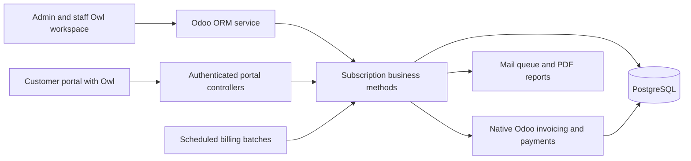
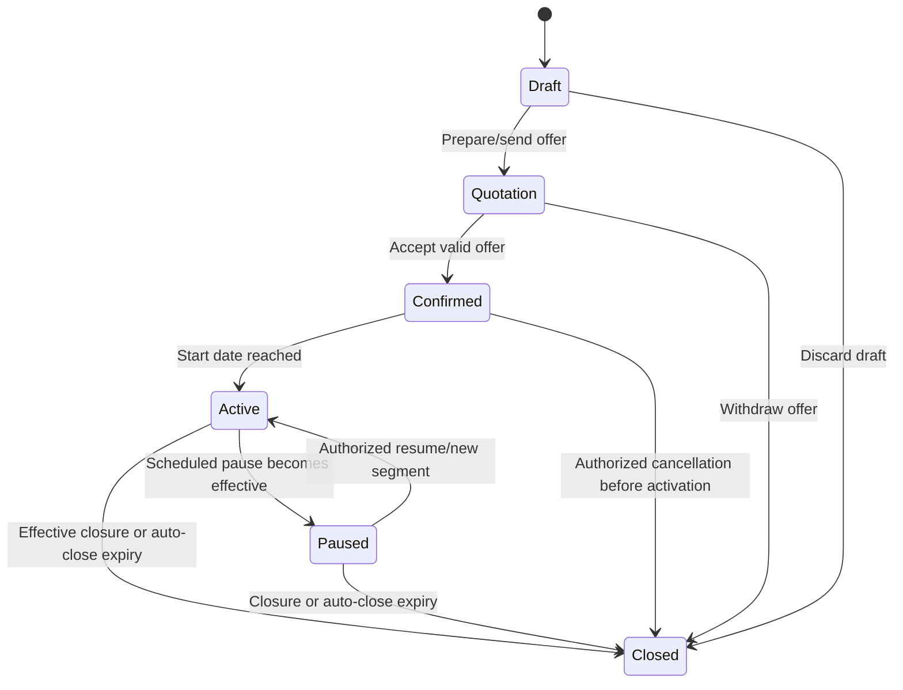

# Ayalvasis implementation plan: Odoo + Owl

Status: application implemented and locally validated, 31 October 2026.
The Odoo addon and both Owl interfaces are implemented. See `VALIDATION.md` for
executed evidence and remaining deployment gates; this plan is not a claim that
cloud hosting, SMTP or production capacity has been verified.

## Implementation status

P1–P8 have working implementations and local acceptance evidence. The staff workspace
uses Owl for search, pagination and financial summaries, with native Odoo forms for
catalog, contract and accounting workflows. The portal uses a separate Owl asset
bundle and ownership-checked HTTP routes. Quotation templates are custom subscription
records; accepting one creates the linked native sales order.

P9's local CI tooling, image-only fresh installation/upgrade, concurrency checks,
browser journeys and database/filestore recovery drill are implemented. Production
sign-off remains open for hosting, real accounting configuration, SMTP, vulnerability
review, hosted CI and external monitoring/backups. `VALIDATION.md` records the
executed tests, benchmark scope and these remaining gates.

The detailed stage estimates below are the original planning estimates, not a log
of elapsed implementation time. Illustrative API names in the design map to the
actual guarded model methods in `addons/ayal_subscription/models/`.

## 1. Outcome and scope

Deliver one application in which an administrator defines products, variants, plans,
taxes and discounts; staff prepare quotations and manage subscriptions/invoices;
customers manage their own subscriptions through a portal; finance sees reliable
collection and recurring-business metrics. Recurring billing must recover from
interruptions without duplicate invoices or skipped billable periods.

Requirements source: the supplied four-page `Subscription_Management_System-1.pdf`
(local source: `/home/edson/Downloads/Subscription_Management_System-1.pdf`). The
policies identified below as design defaults resolve ambiguities in that brief;
they are proposals, not additional requirements claimed to come from the document.

The required first release includes all four billing cadences, variants, quotation
templates, lifecycle policies, scheduled invoices, rule-based discounts, manual
payment recording, the portal and reporting. Payment-gateway integration, usage
metering, multi-currency sales, complex revenue recognition and multiple merchant
tenants are later extensions. No mandatory brief requirement is classified as optional.

## 2. Architecture and technology decisions

| Area | Decision |
| --- | --- |
| Platform | Existing pinned Odoo Community 19 image and its bundled Owl runtime |
| Backend | Python models, Odoo ORM, PostgreSQL; one modular application |
| Internal custom UI | Owl client actions inside Odoo's authenticated web client |
| Routine administration | Native Odoo form/list/search views, with custom fields and policies |
| Customer UI | Odoo portal pages with mounted Owl components |
| Templates/styles | QWeb/XML and scoped SCSS using Odoo's available UI foundations |
| Browser code | ES modules in JavaScript, JSDoc contracts where useful; no extra TypeScript build pipeline initially |
| Background processing | Batched Odoo scheduled actions; durable billing-period records |
| Financial records | Native invoices, taxes, payment terms, payments and reconciliation |
| Reports/email | QWeb PDFs, Odoo mail templates and delivery queue |
| Tests | Odoo Python tests, HOOT component tests, browser tours, targeted concurrency/load tests |
| Deployment | Existing Docker, PostgreSQL, Caddy, secret and recovery infrastructure |

Use one custom addon, `ayal_subscription`, organized by domain. It depends on
`base`, `web`, `mail`, `auth_signup`, `portal`, `product`, `sale_management`, and
`account`. Validate the installation dependency graph against the pinned image.
The plan does not assume access to Enterprise subscription modules.

Owl client actions are registered with Odoo's action registry. Portal components
use the separate public-components mechanism; they do not inherit the entire
internal web client. [Client actions](https://raw.githubusercontent.com/odoo/documentation/19.0/content/developer/howtos/javascript_client_action.rst),
[portal Owl components](https://raw.githubusercontent.com/odoo/documentation/19.0/content/developer/howtos/frontend_owl_components.rst).



All lifecycle, authorization and money decisions run on the server. Browser state
and button visibility provide usability, not authority. The portal receives a
restricted response projection rather than general access to accounting models.

## 3. Complete requirement-to-delivery mapping

| ID | Required behavior | Implementation | Acceptance evidence |
| --- | --- | --- | --- |
| R01 | Unique-email signup/login/reset | Extend `res.users` and existing signup/reset flows | Duplicate/race tests; reset token expiry/reuse tests |
| R02 | Password longer than 8, upper/lower/special | Shared server validator across signup, reset and password changes | Boundary tests at 8/9 characters and missing character classes |
| R03 | Admin/staff/customer separation | Groups, ACLs, record rules, field restrictions, method guards | Denial tests for UI, RPC, imports and direct calls |
| R04 | Only admin creates staff | Restricted provisioning action plus user/group-write enforcement | Staff and public users cannot create or promote employees |
| R05 | Products and variant surcharges | Native product/attribute records with controlled pricing | Variant adding 560 affects the price exactly once |
| R06 | Plans, minimum quantity, availability | Custom plan and default-line models | All cadences, invalid dates and quantity boundaries |
| R07 | Auto-close, early close, pause, renewal policies | Server lifecycle commands and scheduled transitions | Allowed/forbidden actions verified per plan |
| R08 | Reusable quotation templates and validity | Subscription quotation templates; native sale order on acceptance | Template creates correct lines; expired quote cannot confirm |
| R09 | Numbered subscriptions and full lifecycle | Custom subscription/line records linked to quotation | Draft through Closed with guards and audit trail |
| R10 | Automated, duplicate-safe recurring invoices | Billing-period ledger and batched cron | Concurrent/crash/retry/catch-up tests |
| R11 | Taxes and invoice confirm/cancel/send/print | Native accounting and reports with controlled actions | Totals, states, cancellation/reversal and PDF tests |
| R12 | Fixed/percentage conditional discounts | Rule, eligibility, allocation and redemption models | Threshold, scope, validity and last-use concurrency tests |
| R13 | Method/amount/date/note payment tracking | Native payment registration/reconciliation | Partial/full/excess payment and residual-balance tests |
| R14 | Customer's own portal records/actions | Authenticated routes and Owl components | Cross-customer record/PDF access denied |
| R15 | Active subscriptions/revenue/payments/overdue filters | Server aggregation and Owl dashboard | Known fixtures reconcile to underlying records |
| R16 | Responsive pages with thousands of records | Pagination, indexes, query budgets, load testing | Documented browser/API measurements against the two-second requirement |

## 4. Business defaults to use during implementation

These choices make the design implementable. Record any revisions before coding the
affected domain; preserve the same policies in tests, UI explanations and reports.

### Dates, pricing and quantities

- Store contract start and displayed expiry as business dates; expiry is inclusive.
  Internally bill half-open periods `[start, end)`, with service end at expiry + 1 day.
- Use a configured company billing timezone. Persist event timestamps in UTC and
  calendar-based schedules as business dates. Do not derive the business day from
  the container's timezone.
- Bill in advance. Due dates come from the customer's snapshotted payment terms.
- Daily/weekly periods advance by days/weeks. Monthly/yearly periods use the original
  segment's calendar anchor. January 31 -> February 28 -> March 31 in a non-leap year;
  February 29 annual anniversaries clamp in non-leap years and recover in leap years.
- Prorate a shortened final service period using active calendar days divided by
  nominal period days, before currency rounding. Never bill beyond the service end.
  Mid-period upgrades/downgrades are deferred; scheduled quantity changes apply at
  the next billing boundary and retain the old revision for earlier periods.
- The plan price overrides the primary product's base unit price for the selected
  cadence. Additional recurring lines use their configured per-period unit prices.
  Apply a variant surcharge once. Do not add both the product base price and plan
  base price for the same primary line. Show this calculation in the quote preview.
- Quantity is a positive integer for the first release. The plan's minimum applies
  to its primary subscription line. Keep cost price internal and restrict its field.
- One company and one sales currency initially, with `company_id` and currency links
  on every relevant model. Cross-company inputs remain forbidden even in this scope.

### Contract and invoice behavior

- Quote prices are saved when drafted; confirmation freezes the accepted contractual
  revision. Later product/plan edits do not rewrite accepted contracts or invoices.
- Availability dates restrict new quotations/confirmation and renewals, not already
  accepted contracts. Provide explicit admin amendment actions with reasons.
- Confirmation before the start date creates Confirmed state. At the start date,
  activation becomes eligible; confirmation on a current start date can activate
  in the same guarded operation. Backdated starts require an admin reason and show
  the catch-up invoice preview before confirmation.
- Pause and early-close requests take effect at the next billing boundary, capped
  by service end. The UI shows the effective date before the customer confirms.
- While paused, create no billable periods. Resume starts a new billing segment and
  calendar anchor on the chosen current/future business date. Pausing does not
  silently extend the original expiry. A past-expiry contract cannot resume.
- Renewal creates a linked successor contract, preserving the original history.
  Allow only one non-cancelled successor per original term and prevent overlapping
  terms. A future renewal must not bill before its start date.
- On expiry, billing always stops. If auto-close is enabled, transition to Closed;
  otherwise flag "expired, awaiting closure" and require manual closure. Such a
  contract does not count as an active service in the dashboard.
- Scheduled billing creates Draft invoices by default. Staff confirm/post them.
  Optional automatic posting is an explicit administrator setting after tests pass.
- Unposted cancellation never automatically generates a replacement. Use an explicit,
  audited correction/reissue command. Posted corrections follow Odoo credit-note/
  reversal workflows; no deletion or direct rewriting of financial history.

### Discount and payment behavior

- No discount stacking on the same amount initially. Choose the eligible rule with
  highest explicit priority, then stable ID as a tie-breaker. Display the chosen rule.
- Thresholds use the eligible pre-discount, untaxed subtotal and eligible quantity.
  Percentage values are 0..100; fixed values are nonnegative, currency-specific and
  capped at the eligible subtotal. Admin-only rule creation/update applies server-side.
- Product scope uses matching lines; subscription scope uses all eligible recurring
  lines. Distribute a fixed discount proportionally with deterministic rounding.
  Use Odoo's tax calculations after discount allocation, including inclusive taxes.
- Evaluate validity at the period's service-start date in the billing timezone. A
  late catch-up run uses that date. Save the applicable rule revision and calculation
  inputs; do not change a drafted invoice because the rule expires before posting.
- A usage limit is global per rule. One invoice period consumes one use of a rule,
  even if multiple lines benefit. Draft invoices reserve uses; posting consumes the
  reservation. Cancelling an unposted invoice releases it. Reversing a posted invoice
  does not automatically restore the use. Reissue must preserve these semantics.
- Support manual payments first. Outstanding amount is derived from reconciliation,
  not a frontend "paid" flag. Overpayments become explicit unapplied customer credit;
  refunds and write-offs require an authorized finance/admin action and a reason.

## 5. Models and integrity rules

| Model | Important fields and responsibility |
| --- | --- |
| `ayal.subscription.plan` | Name, code, primary product, cadence, base price, currency, min quantity, availability, auto-close/early-close/pause/renew flags, active |
| `ayal.subscription.plan.line` | Default product variant, quantity, recurring unit price and ordering for template creation |
| `ayal.subscription` | Number, customer, company, plan, sale order, start/expiry, state, next due date, payment terms, current revision, successor/predecessor |
| `ayal.subscription.line` | Accepted product/variant description, quantity, price, tax references and commercial revision |
| `ayal.subscription.revision` | Effective-from date, accepted terms snapshot, actor/reason; includes cadence/anchor changes and scheduled amendments |
| `ayal.subscription.event` | Actor, event, old/new state, effective date, timestamp, reason and request key |
| `ayal.billing.period` | Subscription, revision, service start/end, nominal end, currency, calculation snapshot, state, current invoice and attempts |
| `ayal.billing.run` | Started/finished times, trigger, counts, progress, failure summary and heartbeat |
| `ayal.billing.attempt` | Run, period, attempt number, safe error code/message, retry eligibility; exclude secrets/customer-sensitive payloads |
| `ayal.discount.rule` | Type/value/currency, scope, product links, thresholds, inclusive validity dates, priority, limit and rule revision |
| `ayal.discount.redemption` | Rule, period, invoice, reserved/consumed/released state and applied amount |
| `ayal.operation.request` | Scoped idempotency key, operation, user/company, payload digest and result reference for mutating commands |

Extend `sale.order.template`, `sale.order`, `account.move` and relevant invoice lines
with plan/subscription/period/revision references. Reuse native customer/product/tax/
payment records. Keep Odoo invoice posting state separate from its payment status:
the brief's Confirmed maps to posted, and Paid derives from payment/reconciliation.

Database constraints: unique subscription number per company; one subscription per
accepted quotation; unique billable period per subscription and service-start date;
positive period length; one redemption reservation per rule/period; unique operation
key per actor/company/operation; normalized account-email uniqueness. Enforce
non-overlapping service periods under a subscription lock, with a database exclusion
constraint if supported by the final schema. Archive referenced catalog records.

One period points to its current invoice. Keep cancelled/reversed invoice history
linked separately. Any reissue must lock the period, validate the prior financial
resolution, and atomically update the current invoice reference. A unique period
alone is not sufficient if a second invoicing path can bypass that record.

For subscription quotations, block the normal sale-order "create invoice" path on
the server, not only in the UI. All recurring invoice creation goes through the
billing service. Test direct calls to the native invoicing wizard/method as well.

## 6. State transitions and command contracts



Paused is an explicit additional state needed for the brief's pause policy. Pending
pause/close requests are scheduled events, not premature state changes. An expired
non-auto-close contract remains open with an expiry flag until manual closure, but
has no active-service entitlement or further billing eligibility.

All commands validate role, ownership/company, expected revision, current state,
effective date and plan policy. Repeated requests with the same key and payload
return the original result; reusing a key for different input returns a conflict.

Proposed public model methods (custom methods to implement):

| Method | Caller and purpose |
| --- | --- |
| `get_workspace_data(filters, limit, offset)` | Staff: validated, scoped, paginated subscription results |
| `get_subscription_detail(id)` | Staff: allowed fields, timeline, financial summary and actions |
| `action_prepare_quotation()` | Staff: apply template and return quotation action |
| `action_confirm(request_key, expected_revision)` | Staff/admin: accept quote and freeze contract exactly once |
| `action_request_pause(effective_date, request_key)` | Authorized staff/owner, through shared policy checks |
| `action_resume(resume_date, request_key)` | Authorized staff/owner: establish valid next billing segment |
| `action_request_close(reason, request_key)` | Authorized staff/owner: schedule permitted closure |
| `action_create_renewal(request_key)` | Staff or permitted owner: draft one successor |
| `preview_next_invoice()` | Authorized reader: server-calculated preview without usage reservation |
| `action_enqueue_due()` | Admin/finance: request a billing run and return promptly |
| `action_retry_failed(period_ids)` | Admin/finance: queue eligible failures without bypassing deduplication |
| `get_dashboard(filters)` | Staff/admin: aggregates using a documented metric definition |

Private calculation/processing methods implement reusable behavior. Public ORM
methods still require guards: private naming alone is not the authorization model.

## 7. Owl frontend implementation

### Internal application

Add an Ayalvasis menu group with Dashboard, Subscriptions, Billing, Customers,
Catalog, and Settings. Register the custom workspace/dashboard/billing views as
`ir.actions.client` actions. Open native accounting, quotation and catalog views
from those actions where they already provide the needed behavior.

| Screen | Main Owl components | Data and actions |
| --- | --- | --- |
| Dashboard | `Dashboard`, `MetricCard`, `FilterBar`, `RevenueChart`, `OverdueTable` | Aggregates, date/status filters, links to underlying records |
| Subscription workspace | `SubscriptionWorkspace`, `SubscriptionTable`, `StatusBadge`, `Pager` | Search, sort, bounded pagination, state and next billing date |
| Subscription detail | `SubscriptionDetail`, `LifecycleTimeline`, `LineSummary`, `ActionBar` | Contract revision, scheduled actions, invoices, audited commands |
| Quote preview | `QuotePreview`, `PricingBreakdown`, `ValidationSummary` | Server totals, variant adjustments, discount/tax explanations |
| Billing console | `BillingConsole`, `RunSummary`, `PeriodTable`, `FailurePanel` | Due periods, dry-run preview, enqueue, progress and retry |
| Customer portal | `PortalSubscriptions`, `PortalSubscriptionDetail`, `PortalInvoices`, `PlanActionDialog` | Own records, permitted actions, PDFs, balances and effective dates |

Shared UI states: initial loading, empty result, filtered empty result, permission
denied, validation failure, stale data, offline/network failure and successful action.
Use skeletons for loading, clear inline errors, keyboard-accessible controls, visible
focus, labelled dialogs and responsive tables/cards. Never show an unconfirmed
financial mutation as successful through optimistic updates.

Use `setup()`, `useState`, lifecycle hooks, validated props and namespaced XML templates
such as `ayal_subscription.SubscriptionWorkspace`. Use `useService("orm")` for internal
model calls and available dialog/notification/action services for the internal web
client. Keep service adapters separate from presentation components. [Services](https://raw.githubusercontent.com/odoo/documentation/19.0/content/developer/reference/frontend/services.rst).

Keep filters in navigable URL/action state, debounce search, and discard stale
responses when filters change or a component is destroyed. Refetch authoritative
state after a mutation; use a request key and disable duplicate submission while
pending. Send decimal input as validated strings where needed, and format returned
money with the supplied currency. Do not calculate invoice totals in JavaScript.

Start billing-progress refresh with bounded polling while the screen is visible;
stop timers on unmount. Add live bus notifications only if operational need justifies
them. Core billing correctness must not depend on WebSocket delivery.

### Customer portal and assets

Serve `/my/subscriptions` and detail pages through authenticated Odoo portal routes.
Mount portal components using `registry.category("public_components")` and
`<owl-component>` in QWeb pages. Put portal/shared assets in `web.assets_frontend`,
internal/shared assets in `web.assets_backend`, and component tests in
`web.assets_unit_tests`. Avoid broad globs that accidentally load internal startup
code into public pages. [Portal integration](https://raw.githubusercontent.com/odoo/documentation/19.0/content/developer/howtos/frontend_owl_components.rst).

Portal components use an explicit portal transport adapter. They must not import
backend-only action-manager/navigation dependencies. Read endpoints return only
safe fields, formatted summaries and server-computed allowed actions.

Use authenticated HTTP POST routes with explicit CSRF protection for portal
mutations, and read-only GET routes for lists/details. Obtain the token through
Odoo's page rendering. Handle expired sessions and non-JSON authentication responses
without exposing tracebacks. Financial responses use private/no-store caching.

Proposed routes: `/my/ayal/subscriptions/data`, `/my/ayal/subscriptions/<id>/data`,
and explicit `pause`, `resume`, `close`, `renew` POST actions beneath that record.
Invoice PDF routes must validate both invoice ownership and attachment access.
They invoke the same business methods as staff actions; customers never choose a
trusted `partner_id`, `company_id`, price, tax or payment state in a request.

## 8. Identity and authorization

| Operation | Admin | Internal staff | Customer |
| --- | --- | --- | --- |
| Create staff or change roles | Yes | No | No |
| Configure products/plans/taxes/discounts | Yes | Read necessary fields | Published/own relevant fields only |
| Prepare quotes/manage customers | Yes | Yes, permitted company | Own profile/quote visibility only |
| Confirm/amend contracts | Yes | Confirm; restricted amendments | Only explicitly exposed policy actions |
| View subscriptions/invoices | Company scope | Company scope | Exact owned customer scope |
| Pause/resume/close/renew | Subject to audited policy | Subject to policy | Own records, only when policy permits |
| Post invoices/register payments | Yes | Explicit finance capability | No |
| Trigger/retry billing | Yes | Explicit finance capability | No |
| View financial dashboard | Yes | Authorized summaries | Own balances only |
| Read product costs | Yes | No by default | No |

Keep finance as a permission within the internal-staff role, not an extra required
public account type. Avoid broad settings-manager groups for staff. Audit the native
groups inherited from sales/accounting because Odoo grants can be additive.

Use normalized, trimmed, case-insensitive account emails with a database uniqueness
guarantee for actual login identities, including archived accounts. Do not normalize
away plus-addressing or provider-specific dots. Review existing service/template
users and duplicates before introducing the constraint. Share one password validator
across all customer/staff account paths; never log raw passwords or reset tokens.

Enable open customer signup only after the new validation and role restrictions pass.
Public signup accepts a minimal allowlist of fields and always assigns the portal
role server-side. Reuse Odoo hashing/reset mechanisms, add rate limits, generic reset
responses, and tests for expired/reused tokens and concurrent registration.

Record rules must cover subscriptions, periods, invoices, payments and attachments;
portal projections must not leak cost, staff notes or other customers through nested
records. Default ownership is the user's explicitly linked customer partner, not every
contact in an arbitrary commercial hierarchy. Broader company-account sharing is a
future explicit feature. Avoid broad `sudo()` in customer routes; narrow privileged
work requires an already verified actor, record and field allowlist.

Audit native invoice, report, attachment and token-sharing routes as well as custom
routes. Project documents must follow the same owner policy through every path;
disable anonymous/share-token access for these documents until an explicit sharing
policy is implemented. A secure custom download route does not secure a permissive
native alternative automatically.

Odoo's model ACLs, record rules and field restrictions are complementary. Test the
effective permissions with inherited groups, not only the custom ACL file.
[Security reference](https://raw.githubusercontent.com/odoo/documentation/19.0/content/developer/reference/backend/security.rst).

## 9. Reliable billing and discount concurrency

For each due subscription, the worker performs the following bounded operation:

1. Claim/lock the subscription. Re-read lifecycle dates, pending changes and current
   revision; do not trust a candidate list generated before the lock.
2. Determine its next unprocessed billable interval, respecting pause segments,
   original calendar anchors, expiry and any previously claimed period.
3. Create or find the unique period. If it already has a valid invoice, return that
   result. Do not recreate an intentionally cancelled period automatically.
4. Lock applicable discount-capacity records in deterministic order, then recalculate
   eligibility and remaining capacity. Previewing never takes a reservation.
5. Build the native invoice using frozen inputs and server tax/currency rules;
   create reservations and link the invoice to the period.
6. Save the next billing cursor and audit events in the same transaction. Commit
   invoice, period, discount reservation and cursor together, or roll them all back.
7. Queue eligible notifications after durable financial state exists. Track delivery
   separately; an email retry must not create another invoice.

Use small cron batches and framework-supported progress reporting. Avoid one large
transaction covering hundreds of subscriptions. For a period failure, roll back its
work before writing a safe failure record; let remaining subscriptions proceed.
Where a uniqueness conflict is caught, use a savepoint or restart the transaction
before reading the winning row. [Scheduled-action batching](https://raw.githubusercontent.com/odoo/documentation/19.0/content/developer/reference/backend/actions.rst).

The scheduler repeatedly selects due/unprocessed periods, so downtime produces
catch-up work rather than lost billing. Cap work per invocation, apply retry backoff,
and expose permanently blocked periods to an operator. Keep cursor advancement
independent of invoice payment; arrears must not cause duplicate current-period bills.

Email delivery is at-least-once unless a provider supports a deduplication key. Track
attempts and message identity and explain ambiguous delivery separately from billing
success. Do not claim exactly-once external side effects from a database transaction.

## 10. Reporting definitions and performance

| Metric | Definition |
| --- | --- |
| Active service subscriptions | State Active, start reached, not expired, no effective pause/closure |
| Invoiced amount | Posted customer invoices minus posted credit notes in the selected invoice-date range |
| Cash received | Posted inbound customer payments less relevant outbound refunds by payment date; show allocation separately |
| Outstanding | Residual balances of posted customer invoices; do not subtract unrelated unapplied credit silently |
| Overdue | Positive outstanding balance on payment-term items whose due date is before the company business date |
| MRR (additional metric) | Active contractual recurring value normalized monthly, excluding tax; annual /12, weekly *52/12, daily *365/12; disclose these conventions |

Show billed, collected and outstanding amounts as separate labelled metrics. MRR
is a commercial indicator, not accounting revenue recognition. Credit/refund timing
and installment due dates must be covered in the fixture expectations.

Start with indexed database aggregation, bounded pagination and ORM prefetching.
Index company/status/due date for billing, customer/state for portal lookup and
period/invoice foreign keys. Use query plans to justify additional indexes; avoid
fetching all lines/invoices into Python or the browser for dashboard calculations.

Performance acceptance dataset: at least 10,000 subscriptions, 100,000 historical
invoices, mixed periods/discounts/payments and 20 concurrent interactive users while
a billing batch runs. This is a proposed test workload, not the brief's exact sizing.
Record host resources, cache state, network conditions, p50/p95/p99 and failures.
Target p95 interactive pages under two seconds, and examine every tested journey
against the brief's two-second response requirement rather than treating p95 alone
as proof that every page always meets it. Cold loads and mobile views need explicit
measurements. PDF generation and large exports use separate measured job budgets.

## 11. Repository structure to add

```text
addons/ayal_subscription/
  __init__.py
  __manifest__.py
  models/
    subscription.py, subscription_line.py, subscription_revision.py
    plan.py, billing_period.py, billing_run.py, discount.py
    operation_request.py, subscription_event.py
    sale_order.py, sale_order_template.py, account_move.py, res_users.py
  controllers/
    portal.py, signup.py
  security/
    groups.xml, ir.model.access.csv, record_rules.xml
  data/
    sequences.xml, cron.xml, mail_templates.xml
  views/
    menus.xml, client_actions.xml, plan_views.xml, subscription_views.xml
    quotation_views.xml, discount_views.xml, billing_views.xml, portal_templates.xml
  wizard/
    subscription_amendment.py, invoice_correction.py
  report/
    subscription_report.xml
  static/src/
    shared/       # presentation, formatting and safe shared styles
    backend/      # dashboard, workspace, billing, internal transport
    portal/       # portal components and explicit portal transport
  static/tests/
    workspace.test.js, billing.test.js, portal.test.js, pricing.test.js
  tests/
    test_identity.py, test_security.py, test_catalog.py, test_lifecycle.py
    test_billing.py, test_discounts.py, test_payments.py, test_portal.py
    test_reporting.py, test_concurrency.py
  migrations/    # versioned migration scripts when schema changes require them
```

Names are a target layout, not existing files. Include Python imports and manifest
data/assets in explicit dependency order. Keep synthetic demo/performance fixtures
in developer/test tooling; production initialization continues to exclude demo data.

## 12. Implementation sequence and definition of done

Estimates are provisional engineer-days for someone comfortable with Odoo; they
exclude hosting procurement and assume reuse of standard Odoo modules. The deadline,
team size and Odoo experience remain unknown. These are effort ranges, not a promised
calendar schedule. Dependency-aware work can overlap after contracts are stable.

| Stage | Work | Depends on | Exit gate | Effort |
| --- | --- | --- | --- | --- |
| P0 | Existing infrastructure | Complete | See `VALIDATION.md` | Already done |
| P1 | Addon scaffold, version/API spike, policy fixtures, one internal and one portal Owl component | P0 | Installs on fresh DB; both asset contexts load; tests run | 1-2 days |
| P2 | Identity/RBAC, products, variants, plans, company/accounting setup | P1 | R01-R07 model/permission tests pass; no privilege escalation | 3-5 days |
| P3 | Quotation templates, contract snapshots, lifecycle, pause/resume/renewal | P2 | Valid quote becomes one contract; every transition guarded | 3-4 days |
| P4 | Billing-period ledger, invoice generation, taxes, scheduling, retry/catch-up | P3 | Concurrency/crash tests pass; rerunning a period cannot duplicate an invoice | 4-6 days |
| P5 | Discount reservations, posting/corrections, payments, email/PDF | P4 | Last-use races, partial payments and document delivery tests pass | 3-5 days |
| P6 | Full Owl staff workspace, dashboard shell, billing console and UX polish | P3-P5 | Staff completes the full workflow without raw model tooling | 3-5 days |
| P7 | Customer Owl portal, secure actions/downloads, mobile/accessibility | P2-P5 | Own-record journeys pass; cross-customer requests fail | 2-4 days |
| P8 | Reconciled reports, indexes and performance tuning | P4-P7 | Known totals match; documented workload meets agreed response targets | 2-3 days |
| P9 | Business CI, staging migration/restore drills, release review and demo | P1-P8 | All required R01-R16 gates satisfied; release checklist signed off | 3-5 days |

Total provisional effort: 24-39 engineer-days. Do not equate dividing this number by
team size with a guaranteed delivery date: billing correctness and review impose
dependencies. For a short hackathon, deliver one complete vertical slice first,
then expand to every required scenario; reduce optional polish/integrations before
dropping required behavior or financial-integrity checks.

First vertical slice: configure one product/variant and monthly plan -> create a
quote -> confirm/activate -> generate one invoice -> record a payment -> view the
customer portal. Then add other cadences, policies, discounts, recovery and reporting.

## 13. Test strategy and acceptance scenarios

Odoo's frontend tests use HOOT and files registered in `web.assets_unit_tests`.
Use mock services for component behavior and browser tours against real backend
records for cross-layer journeys. [Odoo JS testing](https://raw.githubusercontent.com/odoo/documentation/19.0/content/developer/reference/frontend/unit_testing.rst).

| Suite | Required cases |
| --- | --- |
| Identity | Email case/whitespace duplicates, parallel signup, 8/9 character passwords, missing character classes, token replay, reset without account enumeration |
| Permissions | Customer A vs B including PDFs, staff role escalation, admin-only discount/tax writes, RPC bypass, foreign company/partner injection |
| Catalog/quotes | +560 variant exactly once, minimum quantity, availability endpoints, expired quote, template changes after quote creation, double acceptance |
| Calendar/lifecycle | Jan 31 anchors, leap years, business-zone midnight, final partial period, pause at billing time, resume after expiry, concurrent renewal |
| Billing | Simultaneous workers and manual trigger, crash before/after commit, overdue catch-up, failed record isolation, cancelled-period retry, native sale invoice bypass |
| Discounts | Amount/quantity boundaries, 0/100 percent, capped fixed discounts, per-product allocation, expiration during downtime, last-use race, rollback/reissue accounting |
| Payments | Partial/full/excess payment, same-reference duplicate request, credit note, reversal, installment overdue calculation, insufficient finance permissions |
| Owl | Loading/empty/error states, stale response suppression, double-click actions, destroyed components, currency formatting, session expiry, portal/backend bundle isolation |
| Reports | Precomputed expected billed/cash/residual/overdue totals, refunds, date boundaries, paused/expired contract counts, no cross-customer leakage |
| Operations | Module fresh install/upgrade, blocked unsupported migration, restore with real attachment references, no duplicate billing after restored worker starts |

Concurrency tests use independent database connections/transactions, not a single
transaction test that cannot reproduce a race. Inject failures around transaction
boundaries and assert invariants in persisted records. Freeze the business clock in
fixtures; do not wait for the real next day/month during tests.

## 14. Changes needed to the existing infrastructure

- Add an explicit install/update command for the custom addon, using the private
  runtime configuration. Keep it separate from the existing one-time `init` command,
  which correctly refuses initialized databases. Do not reset administrator passwords
  or reinstall base modules during business migrations.
- Extend CI to install `ayal_subscription` in an isolated database, run tagged Python
  tests, HOOT and browser tours, then exercise business records through backup/restore.
  Treat Odoo test failures reported in logs/runner results as failures, not just a
  successful process exit.
- Build a versioned application image containing the addon. Test the exact release
  artifact that will be deployed. Keep the currently pinned infrastructure baseline
  stable while the first addon is developed.
- Add billing metrics: due backlog, age of oldest due period, failures/retries,
  run heartbeat, generated invoices, delivery errors and recovery time. Wire alert
  destinations after hosting is chosen; a local log file is not an alerting service.
- After staging verification, enable signup, configure real SMTP, install the backup
  timer, enable encrypted off-host backups and verify restore. Hosting, DNS, public
  TLS and provider settings remain launch prerequisites.

## 15. Demo and release checklist

Demonstrate admin product/variant/plan setup, staff quotation acceptance, subscription
activation, tax/discount-correct invoicing, partial then full payment, customer-only
portal visibility and report updates. Run billing a second time and show no duplicate.
Show a failed period being retried safely, a rejected cross-customer request and a
scheduled pause with its effective date. Use synthetic seeded accounts and records.

- [ ] All R01-R16 requirements have working paths and passing acceptance evidence.
- [x] Server authorization and ownership checks cover the implemented UI/RPC paths; denial tests pass.
- [x] Implemented lifecycle transitions enforce role/state/date/policy checks and record audit events.
- [x] Invoice retry, contention, catch-up, cancellation/reissue and correction tests pass locally.
- [x] Tested metrics reconcile to accounting fixtures; local read-load measurements and limits are documented.
- [ ] Fresh install, addon update and database/filestore recovery succeed on staging.
- [ ] Production image scan, secret handling, SMTP, monitoring and off-host backups are verified.
- [x] Documentation states remaining operational limits without claiming high availability.

Production confirmations before launch: actual deadline/team availability,
permission to reuse Odoo business modules under the judging rules, company/currency/tax
configuration, and acceptance of the default pause/proration/discount policies. These
do not block the scaffold/API spike; they must be settled before claiming billing
semantics or a delivery date as final.
